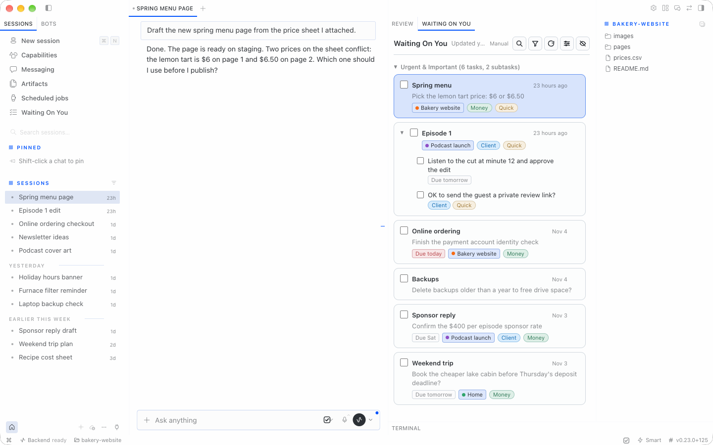
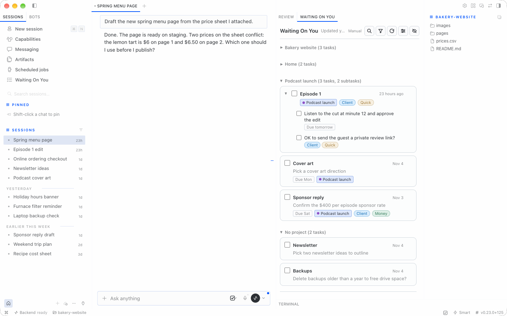
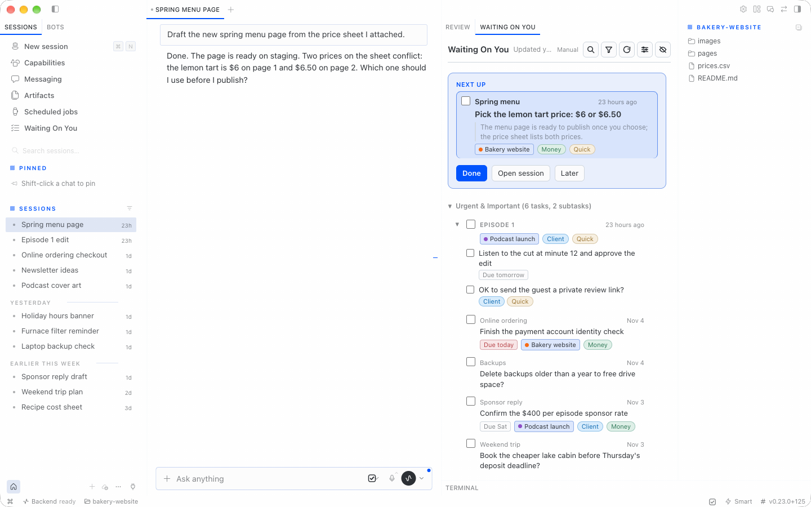
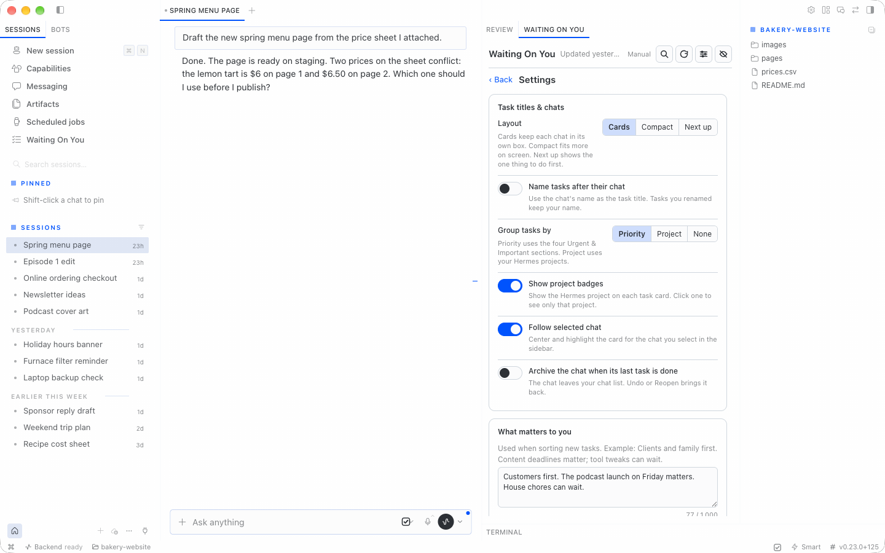
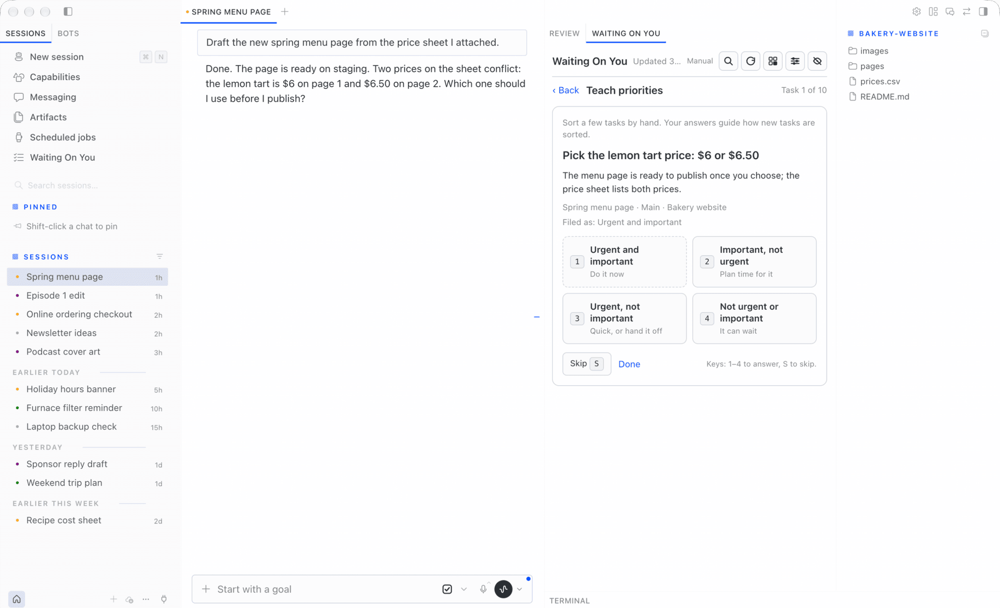
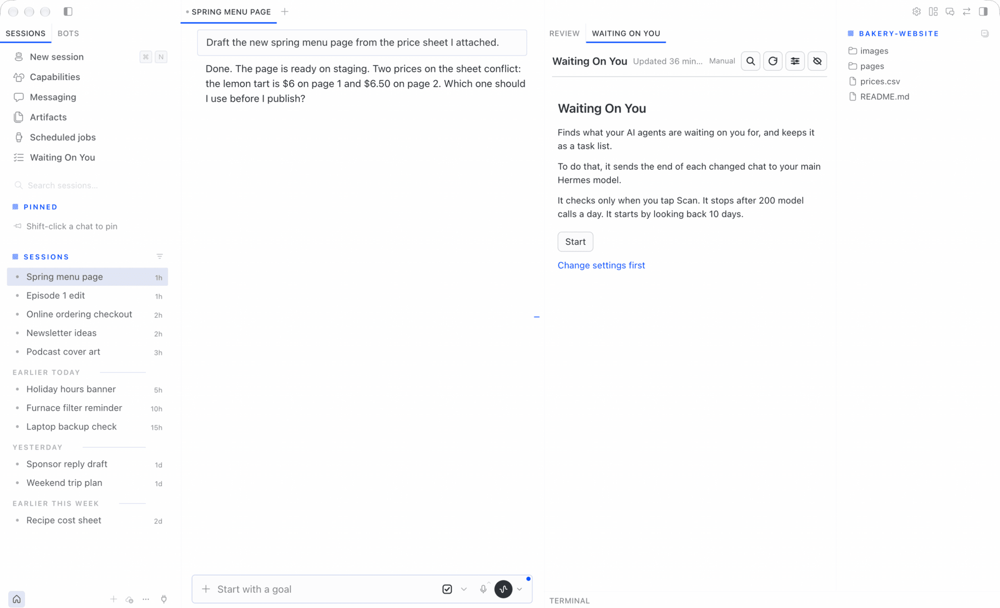

# Waiting On You

A Hermes plugin that watches your agent chats and builds a live task list of what each agent is waiting on you for. Tasks are sorted into Covey quadrants so you can see what matters first.



## Features

- Live list from all chats after each turn (and on a schedule you control)
- Answer from the list: **Yes**, **No**, **Reply**, **Later** or **Open** on the selected task, with single-key shortcuts and five seconds to undo before the answer is sent into that chat
- **Catch up** on one project: every chat in that project that is waiting on you, in one view
- Right-click a chat card (or Shift-F10, or the … menu) to **Close all tasks** in that chat, with confirm and undo
- A **Working** badge on the chat you are looking at while its agent is mid-turn
- Covey quadrants (urgent/important)
- One entry per chat with nested asks grouped together
- Done, not-a-task, snooze (presets + custom date), and move between quadrants
- Undo last action, plus ⌘Z in the panel
- Filters by agent, project and tag behind one Filter button; sort newest or oldest
- Three layouts: Cards, Compact and Next up
- Read-only Hermes Projects, assigned from each chat’s working folder
- Tags with colors and optional hints; automatic tagging is opt-in with a decision provider
- “Why is this here?” shows the agent reply that triggered the task
- Optional archive of a chat when its last unfinished task is marked done
- All Hermes profiles on this Mac, plus other Macs through a small satellite plugin (see [Other machines](#other-machines))

All screenshots use made-up demo chats.

**One chat, two asks.** Asks from the same chat nest under one card. Group by Project to see each Hermes project together, with a **No project** section for chats outside a project folder.



**Next up.** One of three layouts. It puts the first task in a box with Done, Open session and Later. Cards (the default) and Compact are the other two.



**Settings.** Pick a layout, choose how tasks are grouped, describe what matters to you, and turn on an optional decision model.



**Teach priorities.** Sort a few tasks by hand so new tasks land in the right quadrant.



**First run.** Nothing is read until you press Start. The side pane explains what is sent to your model and how often.



## Requirements

- Hermes **≥ 0.21.5** on macOS or Linux (Windows scanning is untested; use WSL or a remote hub)
- **Hermes Desktop** for the side panel (the list UI)

## Install

```bash
hermes plugins install clientamp/waiting-on-you-desktop --enable
```

If Hermes asks to install Node dependencies, answer **N**. The panel ships pre-built; those packages are only for building it from source.

Public source: [github.com/clientamp/waiting-on-you-desktop](https://github.com/clientamp/waiting-on-you-desktop).

Once this plugin is listed in the Hermes catalog, you can also use:

```bash
hermes plugins install waiting-on-you-desktop --enable
```

The catalog name is `waiting-on-you-desktop` because another plugin already uses `waiting-on-you`. Your tasks and settings still live in `~/.hermes/plugin-data/waiting-on-you/`, so an earlier install keeps its list. Panel view choices (filters, collapsed groups) start fresh under the new name. If you installed it earlier as `waiting-on-you`, remove that copy first with `hermes plugins remove waiting-on-you`; your task list stays.

In Hermes Desktop, open **Capabilities → Plugins** and turn on **Waiting On You**.

Restart once so the gateway and panel load the plugin:

```bash
hermes gateway restart
```

Also restart the Hermes dashboard / Desktop app.

**Remote Desktop:** Hermes Desktop loads panel JavaScript from the Mac where Desktop runs. If you use Desktop on another Mac, copy `desktop/plugin.js` from this repo to `~/.hermes/desktop-plugins/waiting-on-you-desktop/plugin.js` on that Mac.

## First run

Before you tap **Start**, the panel explains what the plugin does, which model will read chat endings, how often it checks, the daily call cap, and how many days of history it scans. Chat data is not sent to a model until you choose **Start** (that sets consent and runs the first scan); **Test connection** uses synthetic data only. Use **Change settings first** if you want to adjust mode or limits before scanning.

## Privacy — what is sent where

Outbound paths (no telemetry):

- **Classifier:** sends the last user message (up to 300 characters), last agent reply (up to 1500), chat title/date/project, unfinished (open or snoozed) task text, ten recent closed asks, your priority note, and up to eight priority corrections to Hermes’s configured `waiting_on_you` model (main model by default).
- **Priority calibration:** each classification prompt can include up to 8 of your own priority corrections from other chats (task ask + chosen quadrant) as calibration examples. These go to the classifier model and optional decision provider.
- **Rename with AI:** sends the first two and last 30 chat messages, up to 600 characters each, plus task/group naming context to that Hermes model.
- **Suggest tags:** sends up to 200 recent chat titles, project names, and existing tag names to that Hermes model.
- **Priority evaluation:** on explicit confirmation, sends chat excerpts and task context through the classifier and optional decision provider to compare predictions with labels. Evaluated tasks’ labels are held out of calibration examples.
- **Optional decision provider:** receives chat excerpts for gating; asks, context, due dates, projects, priority note/corrections, and tag names/hints for priority/tag scoring. Preset hosts: `api.typesafe.ai`, `api.cloudflare.com`, `api.perplexity.ai`, `api.openai.com`; Ollama/custom uses your configured endpoint. Connection tests send synthetic data only.
- **Satellite → hub:** sends chat excerpts/metadata and the Hermes project catalog to your paired hub, authenticated by a satellite token. The hub stores at most 2,000 chat rows per satellite, keeping the most recently active rows. Optional legacy SSH collection reads configured remote chat databases.

Model-backed chat features require first-run consent. Choose providers and hub addresses you trust.

Tasks and settings live under `~/.hermes/plugin-data/waiting-on-you/` (files are created mode `0600` where the OS allows).

## Choosing a model

In `~/.hermes/config.yaml`, point the auxiliary task at a fast, inexpensive model:

```yaml
auxiliary:
  waiting_on_you:
    provider: xai-oauth   # example — use your provider id
    model: grok-4.6-fast
    reasoning_effort: low
```

A small, fast model is enough; classification does not need your heaviest reasoning model.

## Decision models (optional)

A decision model adds three checks alongside your normal Hermes model:

- **Gate:** skips the normal model call when the chance that a chat needs your reply is below 15%. Chats with open tasks always reach the normal model so answered tasks can close.
- **Priority:** scores urgency and importance together, using your “What matters to you” note and recent corrections. Scores replace the normal model’s values only at 50% confidence or above. Manually locked quadrants stay locked.
- **Automatic tags:** when enabled, applies only tags you already created, at 80% confidence or above. Removing an automatic tag keeps it removed. It never invents tags.

Leave the decision provider empty to turn these checks off. Gate and priority checks default to on when a provider is configured; automatic tagging defaults to off. If a decision request fails or times out, the normal Hermes classification still runs and its tasks are kept. Decision calls and input tokens are counted separately from normal model usage; the normal daily call cap does not cap decision calls.

### Providers and keys

Enter keys in **Hermes Desktop → Settings → Plugins → Waiting On You**. You can also open that page with the gear on Waiting On You’s **Capabilities → Plugins** row. These are Hermes-managed masked credential fields, not keys to paste into this panel or a chat. The plugin reads them only through Hermes’s supported secret API and never returns them in its API responses.

| Provider | Default model | Where to get the key | Hermes credential field |
|---|---|---|---|
| TypeSafe Jev | `jev-latest` | [TypeSafe](https://typesafe.ai/) | `WOU_TYPESAFE_API_KEY` |
| Cloudflare Clef / Clef Flash | `clef` / `clef-flash` | [Cloudflare API tokens](https://dash.cloudflare.com/profile/api-tokens), with Workers AI access; also enter your account ID | `WOU_CLOUDFLARE_API_TOKEN` |
| Perplexity / Perplexity Flash | `pplx-decider-latest` / `pplx-decider-flash-latest` | [Perplexity API settings](https://www.perplexity.ai/settings/api) | `WOU_PERPLEXITY_API_KEY` |
| OpenAI | `gpt-6-luna` | [OpenAI API keys](https://platform.openai.com/api-keys) | `WOU_OPENAI_API_KEY` |
| Ollama / custom endpoint | Enter the served decision model | Your own service; bearer key optional | `WOU_DECISION_API_KEY` |

OpenAI publishes **$0.10 per million input tokens, with free output**, for `gpt-6-luna`. For all other providers, **see provider pricing**; prices and model access can change.

Provider, model, endpoint, account ID, and timeout stay in Hermes’s plugin configuration (`plugins.entries.waiting-on-you-desktop.settings`; an older `plugins.entries.waiting-on-you.settings` block is still read), read and written through `ctx.get_config()` / `ctx.set_config()`. The panel’s gate, priority, and automatic-tagging switches stay in the plugin’s `settings.json`. Keys stay only in Hermes credential storage, never either settings file.

**Privacy:** enabling a decision provider sends chat titles and message excerpts to that provider for the gate. Priority and tag scoring send task text, context, due dates, project names, your priority note, and up to eight recent priority corrections. Choose a provider you trust with that information. Decision errors are stored only as short codes such as `timeout` or `http_401`, never request content or keys.

For **self-hosting with Ollama**, enter your server’s base URL and a model/service that supports the System One decision protocol; the plugin appends `/v1/systemone`. A normal chat-only Ollama model endpoint is not sufficient. A custom endpoint is used as entered. Public endpoints require HTTPS; HTTP is allowed only for `localhost` or literal loopback/private/CGNAT IP addresses; hostnames require HTTPS. **Test connection** sends synthetic data only, not your chats.

A future native Hermes decision adapter is probed first when configured. The reserved adapter stays disabled until Hermes releases a supported decision contract; merely finding a method does not make the plugin guess that contract. External providers remain the working path today.

### Suggestions and live priority checks

**Suggest tags** makes one normal Hermes model call using up to 200 recent chat titles and Hermes project names from the last 30 days, across watched profiles. Existing tag names are included to avoid duplicates. Suggestions are cleaned and are never saved automatically.

The in-host `POST /eval-priorities` route requires first-run consent and `{"confirm":true}` because it spends model calls. It compares stored model predictions (not user-corrected quadrants) with fresh classifications and optional decision scores for up to 25 labeled tasks, without changing tasks or labels. Optional `labels` use `[{"task_id":123,"quadrant":2}]`; otherwise it uses the latest stored correction per task. Unavailable chats/predictions appear as `after: null`. These calls and tag suggestions count as manual model use.

## Cost

A typical classification call is approximately **1.2–2.5k input tokens** and **100–400 output tokens** for a few asks. A character-count estimate (characters ÷ 4, not a tokenizer measurement) gives about 1,155 input tokens with full message excerpts and no history, or 2,090 with a maximum-length priority note and eight full calibration examples. Open/closed task history can add more; ten detailed asks can approach the 1,800-token output cap. The model is only called when a chat has a **new message** since it was last read. On top of that, a few chats that still have open tasks get one re-check a day (at most 5 per scan), to refresh context and detect answered asks. Due-date urgency rises automatically without a model call when the local end-of-day deadline is within 48 hours (including overdue tasks). **Scan now** re-reads every chat with an open task.

As a guide: if you get new agent replies in about 40 chats a day, expect roughly 50–80 calls; at the estimates above that is around 65k–230k input + output tokens a day, depending on history and ask count. The default **daily limit is 200** model calls. Confirmed forced scans may use up to twice your daily limit, never more; `0` keeps unlimited use. Usage for today and the past seven days appears in **Settings**. If usage is far above your number of active chats, lower the limit and tell us.

### `wou_list` tool

Read-only, compact output: `{"total": N, "tasks": [...]}`. Returns the 20 most important open tasks by default (quadrant first, then newest). Each task has `id`, `agent`, `chat`, `topic`, `ask`, `quadrant`, and optional `context`, `due` (local YYYY-MM-DD), `project` (Hermes project name), and `tags` (tag names).

Optional arguments: `quadrant` (1–4), `limit` (1–200), `project` (exact name or key, case-insensitive), and `tag` (exact name, case-insensitive). Filters combine; `total` counts all matching tasks before the limit. Example: `{"project":"default:project-id","tag":"Client","limit":10}`.

Projects come only from Hermes, never the classifier. Local keys are `<profile>:<project_id>`; satellite keys are `<satellite>:<profile>:<project_id>` to avoid cross-machine collisions. No manual project override exists. First use of this version backs up the old task database beside itself as `wou.db.bak-pre-hermes-projects-<timestamp>`, then removes the plugin’s old project assignments. The old table is retained empty.

## Settings

Editable in the panel (stored in `settings.json` in the plugin data directory):

| Setting | Default | Range / values |
|--------|---------|----------------|
| Mode | `auto` | `auto` — after each chat turn plus periodic sweep; `hourly` — sweep only every 60 min; `manual` — only **Scan now**; `off` — no background scans (list still works) |
| Wait after a chat turn (seconds) | 90 | 30–600 |
| Check every (minutes) | 30 | 15–240 (sweep interval in `auto` / `hourly`) |
| Chats per scan | 25 | 5–100 |
| Daily limit (model calls) | 200 | 0–2000 (`0` = no limit) |
| Look back (days) | 2 on new installs; 10 for legacy settings files without a consent field | 1–30 |
| Keep unanswered tasks (days) | 0 (Forever) | 0–365 (`0` = forever) |
| Archive chat when last task done | off | on / off |
| Automatic tags (`auto_tag`) | off | on / off (requires a configured decision provider) |
| Decision gate (`decision_gate`) | on | on / off (used only with a configured decision provider) |
| Decision priority (`decision_priority`) | on | on / off (used only with a configured decision provider) |
| Layout (`layout`) | `cards` | `cards` — each chat in its own box; `compact` — one line per ask, no boxes; `focus` — **Next up** box with the first task and Done / Open session / Later, the rest listed below |
| Name tasks after their chat | off | on / off |
| Group by (`group_by`) | `priority` | `priority`, `project`, or `none`; old `show_priorities: false` migrates to `none` |
| Show project badges | on | on / off |

Lookback controls **new-chat discovery**, not whether an unanswered task is kept. Unanswered tasks are kept forever by default, including existing settings files without `retention_days`. Expiry is opt-in: set a positive retention period to clear an unanswered task only when a successful source read confirms the chat has had no activity for that many days. These tasks appear in history as **Cleared for age · not answered**, with status `expired`, and can be reopened. They are not counted as resolved or done. Missing or unavailable sources, and partial satellite snapshots, are not completion evidence. Manual tasks, tasks with a future due date, future snoozes, and user-locked priorities do not expire this way. When a snooze wakes, its wake time starts a fresh retention window.

Consent is stored explicitly in `settings.json`. Missing, unreadable, or old settings without a consent value require **Start** again; creating a manual task never grants model access. Existing `consented: true` settings are preserved. The legacy 10-day discovery default is retained only for valid pre-consent settings files, not inferred from task data.

**Model** (read-only in Settings): resolved from `auxiliary.waiting_on_you` in `config.yaml`, or “your main Hermes model” if unset.

## Advanced config (`config.json`)

Plugin config JSON (Hermes plugin config, not `settings.json`) nests collection options under **`collect`**. **`action_handlers`** stays at the top level.

```json
{
  "collect": {
    "agent_names": { "default": "Alice", "work": "Bob" },
    "skip_title_prefixes": ["Subagent:"],
    "skip_title_contains": [],
    "local_profiles": [
      { "name": "default", "state_db": "~/.hermes/state.db" },
      { "name": "work", "state_db": "~/.hermes/profiles/work/state.db" }
    ],
    "remote_hosts": [
      { "name": "workstation", "ssh_host": "workstation", "state_db": "~/.hermes/state.db" }
    ]
  },
  "action_handlers": {
    "support:inbox:": {
      "command": ["/absolute/path/to/handler"],
      "timeout_seconds": 60
    }
  }
}
```

Inside **`collect`**:

- **`agent_names`** — map profile or remote host name → display name in the panel
- **`skip_title_prefixes`** / **`skip_title_contains`** — chat titles to skip when scanning
- **`local_profiles`** — the complete list of `{name, state_db}` entries to watch when overriding the default `~/.hermes` layout; it replaces discovery, rather than adding to it
- **`remote_hosts`** — legacy SSH collection; use a [satellite](#other-machines) instead. `{name, ssh_host, state_db}`, read-only from the remote `state.db`. If the host is down the panel shows a warning, and the old cached copy is never sent to the model again.

When `local_profiles` is omitted, the scanner uses `HERMES_HOME` or `~/.hermes`: root `state.db` as profile `default` and each `profiles/<name>/state.db`.

Plain HTTP to a satellite hub is only allowed for literal `localhost`, loopback, private, link-local, or CGNAT addresses (for example `http://127.0.0.1:8787`). Use `https://` for ordinary hostnames.

### Card actions

External producers (for example a support-mail sync script) can attach up to **four** buttons per task. Store them on upsert as JSON `actions`:

| Field | Required | Notes |
|--------|----------|--------|
| `id` | yes | `^[a-z0-9_-]{1,32}$`, unique per task |
| `label` | yes | Button text, max 40 characters |
| `confirm` | no | If set, the panel asks before running (max 200 characters) |
| `style` | no | `primary`, `default` (default), or `danger` |
| `kind` | no | `run` (default) calls your handler; `details` toggles the source excerpt |

In `config.json`, map a **chat_key prefix** to a local handler (no shell):

```json
"action_handlers": {
  "support:inbox:": {
    "command": ["/absolute/path/to/handler"],
    "timeout_seconds": 60
  }
}
```

Longest matching prefix wins. Only **open** tasks with a stored `run` action can execute a handler. The command must be a non-empty argv list starting with an absolute executable path; it runs without a shell, with a timeout clamped to 1–300 seconds (60 by default). Both stdout and stderr are capped at 64 KiB; oversized output fails the action.

On **Run**, the plugin executes `command` with argv: `action_id`, `chat_key`, `source_msg_id` (or empty). A source id must be empty/None or at most 128 characters from `A-Z a-z 0-9 _ . : @ < > + = , -`, must not start with `-`, and cannot contain whitespace or control characters. This accepts producer ids such as `cc_reminders:123`, `client_questions:42`, and comma-separated reminder ids. Read the **last non-empty stdout line** as JSON: `{"ok": bool, "message": str, "close": bool}`. When `ok` and `close` are true, the task is marked done (chats are not archived for non-chat keys).

## Keyboard shortcuts

Desktop keybinds (customize in Hermes Desktop). All use ⌘ on macOS and Ctrl on Windows/Linux:

| Shortcut | Action |
|----------|--------|
| ⌘⌥Y | Show or hide the panel (persists) |
| ⌘⌥R | Scan now |
| ⌘⌥P | Toggle show priorities |
| ⌘⌥B | Toggle show project badges |
| ⌘⌥E | Expand or collapse all groups |
| ⌘⌥A | Show answer buttons on every task, not just the selected one |
| ⌘Z | Undo last action (when the panel is focused) |

When the panel has focus: **Y** yes, **N** no, **R** reply, **L** later, **O** open the chat, **J**/**K** move between tasks. Typing in a text box never triggers these.

Inline answers go only into a chat this window is showing. Chats on another machine or another profile get **Open** and a note instead, so an answer never lands in the wrong chat. See [docs/known-gaps.md](docs/known-gaps.md) for what Hermes does not expose to plugins yet.

The same actions are available from the command palette.

## Troubleshooting

| Problem | What to try |
|--------|-------------|
| Panel missing | Enable the plugin under **Capabilities → Plugins** in Desktop. On a Mac that is not your Hermes host, copy `desktop/plugin.js` to `~/.hermes/desktop-plugins/waiting-on-you-desktop/plugin.js` on that Mac. |
| Sidebar gone on another agent's chat | That Hermes does not have Waiting On You. The list stays on the profile that has it. Switch back to that profile. |
| Settings or projects return 404 | The dashboard may still be running old code — restart the Hermes dashboard / Desktop app and `hermes gateway restart`. |
| “Can't reach Hermes. Retrying…” | Gateway or network issue; confirm `hermes gateway` is up and Desktop can reach it. |
| Nothing appears | Finish **Start** on first run, set mode to something other than `off`, or check whether the daily limit was reached (you can still **Scan now** with confirmation). |
| “… can't be reached” banner | That machine's chats are not coming in. For a satellite, run `hermes waiting-on-you-satellite status` on it. For an SSH host, check `ssh <host>` works without a password prompt. |
| A machine's tasks show up twice | It was paired under a different name than before. Remove it in **Settings → Other machines** and pair again with the old name. |

## Other machines

Waiting On You keeps one task list on one Hermes, **the hub**. It already reads every profile on the hub's Mac. To add chats from another Mac (or another Hermes home), install the small **satellite** plugin there. The satellite reads that Hermes's chats and sends changes to the hub every couple of minutes. It never calls a model and never sees your task list.

If your hub was originally installed under the older plugin name `waiting-on-you`, update every satellite to the current satellite package first, then update the hub to `waiting-on-you-desktop`. Satellites still running the old pairing against a hub that has only been upgraded under the new name will not be able to reach it.

**1. Find your hub address.** This is the hub's Hermes dashboard address as the other Mac sees it. The dashboard listens on port `9119` by default.

- Tailscale: expose the dashboard with Tailscale Serve and use `https://<hub-name>.<tailnet>.ts.net:9119`.
- Same home network: `http://192.168.1.10:9119` (replace with the hub's literal private IP), if the dashboard listens on the network. **Plain HTTP sends the satellite token and chat excerpts unencrypted on the LAN. Hostnames, including `.local`, require HTTPS. Prefer Tailscale Serve with HTTPS (for example `https://hub.example.ts.net`) or another HTTPS endpoint.**

Plain `http` is only allowed for `localhost` and literal loopback, private, link-local, or CGNAT IP addresses. Hostnames, including `.local`, require HTTPS; public IP addresses also require HTTPS.

**2. Make a pairing code on the hub.** Open **Waiting On You → Settings → Other machines → Add a machine**.

- **Name**: a short id such as `studio`. Use one satellite per Hermes home. A Mac running three Hermes profiles needs three satellites with three names.
- **Moving a machine from SSH to a satellite?** Remove its `remote_hosts` entry first, then pair with the old name (for example `juno`) so existing tasks carry over. Pairing rejects names still used by an SSH host or local profile. A different name creates duplicate tasks.
- The code works once and expires after 10 minutes. Settings shows the exact command to run.

**3. On the other Mac:**

```bash
# Copy the satellite folder from this repo into that Hermes home
cp -R satellite ~/.hermes/plugins/waiting-on-you-satellite   # use that Hermes's HERMES_HOME if it is not ~/.hermes
hermes plugins enable waiting-on-you-satellite
hermes waiting-on-you-satellite pair <hub_address> <code>   # prints "Paired as <name>. Sent N chats."
hermes gateway restart
```

**4. Check it.** On the satellite, `hermes waiting-on-you-satellite status` shows the last successful send and any error. On the hub, **Settings → Other machines** shows “Sending tasks · updated …”.

To disconnect, click **Remove** on the hub, or run `hermes waiting-on-you-satellite unpair` on the satellite.

**What is read:** chats from Hermes Desktop, the terminal UI and WebUI from the last 10 days. Chats in messaging apps (Telegram, Slack and so on) and cron runs are not read, on the hub or on satellites.

## Uninstall

```bash
hermes plugins remove waiting-on-you-desktop
```

Your task database stays in `~/.hermes/plugin-data/waiting-on-you/` until you delete that folder.

## License

MIT — see [LICENSE](LICENSE) if present in the repo.

## Security

See [SECURITY.md](SECURITY.md) for what the plugin reads, writes, and reports.


## Priority learning and evaluation

Tasks expose `context`, `due_at` (epoch seconds), `urgency` (0–3), and `importance` (0–3).
A due date means **23:59:59 in the host's local timezone**, including date-specific daylight saving time.
Urgency ≥2 or a deadline within 48 hours makes a task urgent; importance ≥2 makes it important.
Manual moves lock the quadrant against rescans and date escalation. Contextual rewrites keep renamed titles.
Older classifiers returning only `quadrant` remain supported.

`GET /settings` and `PATCH /settings` include `settings.priorities_note` (“What matters to you”),
a string up to 1000 characters (default empty). It and the eight most recent corrections calibrate future calls.

Backend quiz routes (relative to the plugin API prefix):
- `GET /quiz?limit=10` returns `{tasks: [...]}` with open, unlocked, unlabeled, unskipped tasks spread across quadrants (limit 1–100).
  Fields: `id`, `ask`, `context`, `chat_title`, `agent`, `project` (name or null), `quadrant`, `due_at`.
- `POST /quiz/{task_id}` with `{"quadrant": 1}` records a quiz label and locks that task.
- `POST /quiz/{task_id}/skip` with an empty body skips that task. Unknown/closed tasks return 404.

Offline evaluation does not spend model calls:
```sh
python3 -m wou eval-priorities --labels .hermes/labels/labels.json
python3 -m wou eval-priorities --from-db
```
Label files contain `{"labels":[{"task_id":1597,"label":1},{"task_id":2094,"label":null}]}`.
Null labels are skipped. Output includes agreement, missing IDs, and a 4×4 matrix (rows=user, columns=prediction).
Use `--db PATH` for a copied/test database. `--live` explicitly spends model calls to compare fresh predictions
without changing stored tasks; it requires the Hermes configured classifier to be available in the process.
